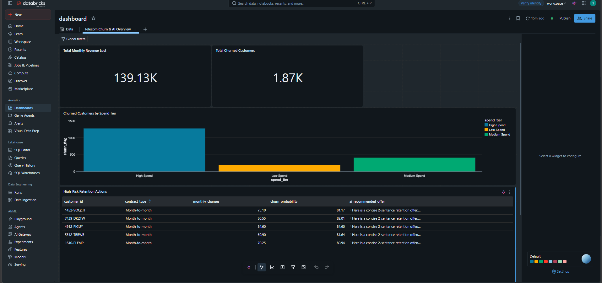
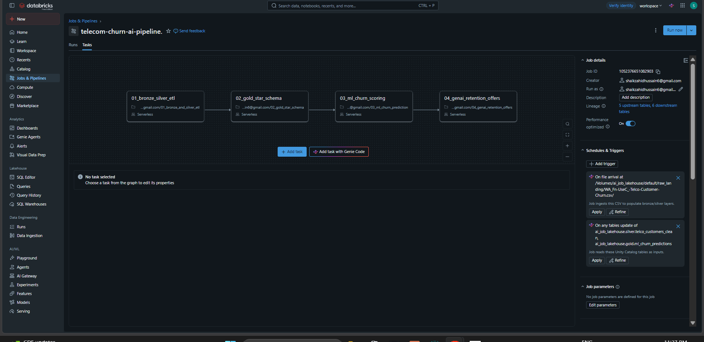
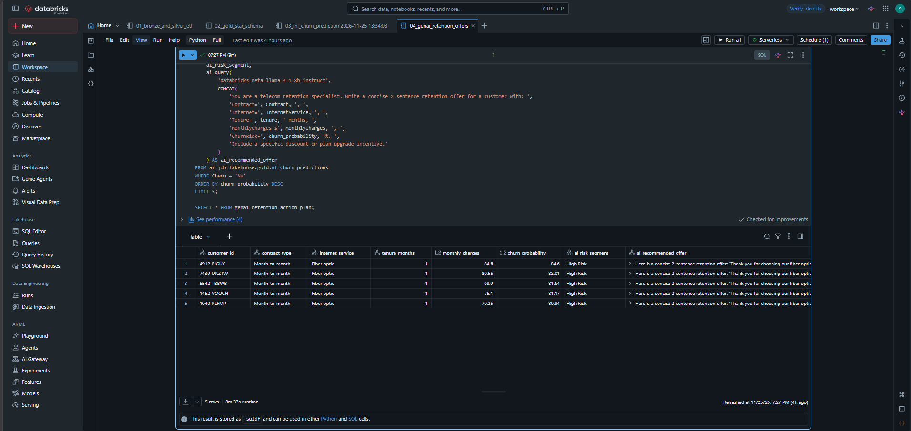
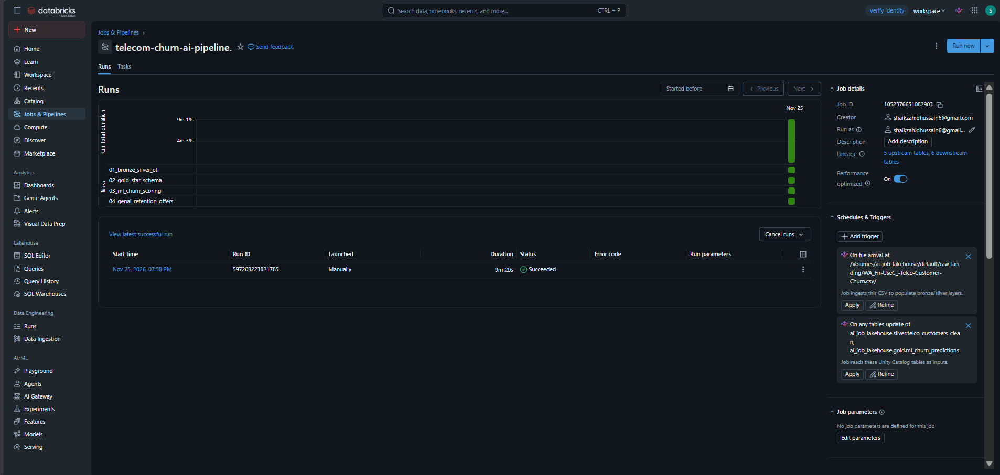

# 🚀 End-to-End Telecom Customer Churn & GenAI Retention Lakehouse

An end-to-end **Data Engineering, Predictive Machine Learning, and Generative AI** Lakehouse pipeline built on **Databricks** using **PySpark, Delta Lake, Unity Catalog, Databricks SQL, MLflow, and Foundation Models (`ai_query`)**.



---

## 📌 Project Overview
Customer churn is one of the biggest revenue leaks in the telecom industry. Instead of stopping at static BI dashboards, this project builds a **production-style automated pipeline** that ingests raw customer records, models an analytical Star Schema, predicts individual customer churn probabilities using Machine Learning, and uses **Generative AI directly inside SQL** to write tailored retention offers for high-risk accounts.

---

## 🏗️ Lakehouse Architecture

```text
[Raw Telecom CSV (7,043 Rows)] 
        │
        ▼  (01_bronze_and_silver_etl.py — PySpark)
[Bronze Delta Table] ──► [Silver Clean & Feature-Engineered Delta Table]
                                │
                                ▼  (02_gold_star_schema.sql — Databricks SQL)
                 [Gold Star Schema: dim_customers, dim_services, fact_churn_metrics]
                                │
                                ▼  (03_ml_churn_prediction.py — Scikit-Learn + MLflow)
                 [Gold ML Predictions Table (79.2% Accuracy | 0.836 ROC-AUC)]
                                │
                                ▼  (04_genai_retention_offers.sql — Databricks ai_query)
                 [GenAI Retention Action Plan + AI/BI Dashboard]
```

### Automated 4-Step Databricks Workflow DAG


---

## 🛠️ Tech Stack
* **Platform & Governance:** Databricks Serverless, Unity Catalog (`ai_job_lakehouse`), Delta Lake, Databricks Jobs & Workflows
* **Data Engineering:** PySpark, Python, SQL (Medallion Architecture + Star Schema Modeling)
* **Machine Learning:** Scikit-Learn (Random Forest Classifier), MLflow Experiment Tracking
* **Generative AI & BI:** Databricks SQL `ai_query()` (`databricks-meta-llama-3-1-8b-instruct`), Databricks AI/BI Dashboards

---

## 📊 Key Business Insights Uncovered
* **Contract Type Drives Churn:** Month-to-month contracts experience a **42.71% churn rate** (1,655 churned customers), putting **\$120,847.10/month** in recurring revenue at risk—nearly **15x higher** churn than Two-Year contracts (**2.83%**).
* **High-Spend Vulnerability:** Customers in the **High Spend (\$70+/month)** tier account for the majority of the **1,869 churned customers** and **\$139.13K** in total monthly lost revenue.
* **Proactive AI Retention:** Combining ML churn scoring (`churn_probability >= 80%`) with automated LLM-generated offers gives retention teams immediate, personalized outreach scripts before customers cancel.

---

## 🤖 Generative AI & Workflow Proof

### 1. Databricks `ai_query()` Retention Action Plan
Uses Meta Llama 3.1 8B Instruct directly inside Databricks SQL to evaluate contract type, tenure, monthly charges, and ML churn risk to generate 2-sentence retention offers:


### 2. End-to-End Automated Job Execution
All four notebooks are orchestrated via Databricks Workflows with dependency management:


---

## 📂 Repository Structure
```text
telecom-churn-genai-lakehouse/
│
├── notebooks/
│   ├── 01_bronze_and_silver_etl.py       # PySpark ingestion, null/type handling & feature engineering
│   ├── 02_gold_star_schema.sql           # Star Schema (dim_customers, dim_services, fact_churn_metrics)
│   ├── 03_ml_churn_prediction.py         # Random Forest churn scoring + MLflow tracking
│   └── 04_genai_retention_offers.sql     # Databricks ai_query() personalized retention offers
│
├── screenshots/
│   ├── 01_aibi_dashboard.png             # Databricks AI/BI Dashboard
│   ├── 02_genai_retention_table.png      # GenAI SQL output table
│   ├── 03_workflow_pipeline_dag.png      # 4-task Databricks Workflow DAG
│   └── 04_job_run_succeeded.png          # Automated pipeline execution proof
│
└── README.md
```

---

## 🚀 How to Reproduce
1. **Create Unity Catalog & Volume:** Create a catalog `ai_job_lakehouse` and a managed volume `default.raw_landing`, then upload `WA_Fn-UseC_-Telco-Customer-Churn.csv`.
2. **Import Notebooks:** Import all 4 files from `notebooks/` into your Databricks Workspace.
3. **Orchestrate Workflow:** Create a Databricks Job chaining `01` → `02` → `03` → `04` on Serverless compute and click **Run now**.